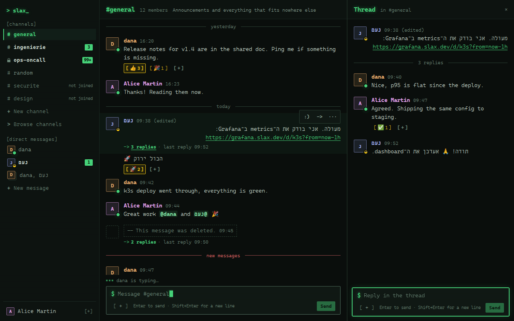
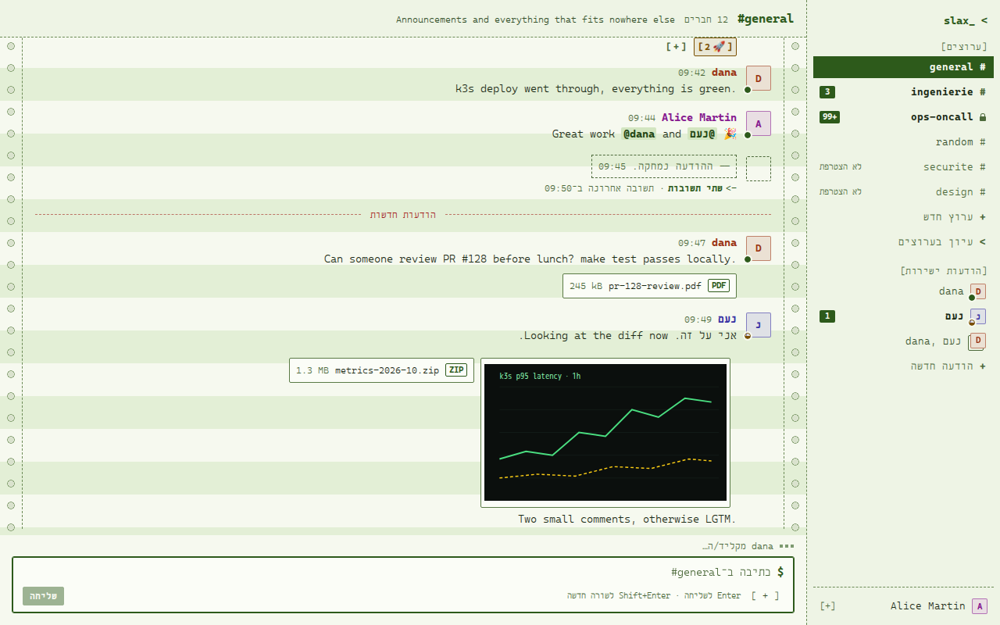

# Slax

[](https://github.com/yechpa/slax/actions/workflows/ci.yml)
[](https://github.com/yechpa/slax/actions/workflows/images.yml)

Slax is a Slack-like team chat, built to show one application designed, deployed and
operated end to end: channels, threads, reactions, files, direct messages and presence, in
English, Hebrew (right to left) and French, with two themes. Its home is
<https://slax.yechpa.com>, a public demo reset every night, on one small AWS Graviton
instance; a development cluster on the tailnet deploys every merge.

<p>
  
  
</p>

*Console (dark, phosphor green) and Listing (light, continuous-form paper), one click apart.*

## What it does

- Public and private channels, real-time messages, threads, mentions, emoji reactions,
  editing and deleting one's own messages.
- Direct messages, one to one and in groups of up to 8.
- Files by drag and drop (10 MB each, 100 MB per account): image and PDF previews,
  checked by a separate scanner before anything is stored.
- Presence (online, away, offline) and "is typing".
- English, Hebrew and French, chosen per person; right to left done with CSS logical
  properties and per-message bidi isolation.
- Sign-in with Google only (no password anywhere), behind Cloudflare Turnstile.
- Administration: service status, audit log, ban, delete, lock; alerts to a Telegram bot.

## How it is built

Laravel 12 (API, Reverb WebSockets, queues) on PostgreSQL 16 and Redis 7; a Preact and
TypeScript SPA with plain modern CSS; a Python upload scanner; S3 for files. Everything is
containerised; dev and prod run the same images on single-node k3s through one Helm chart,
released by GitHub Actions over Tailscale (dev on every merge, prod on a version tag after
approval). Production: one EC2 t4g.small behind Caddy, about $21 a month.

| Read | For |
|---|---|
| [docs/architecture.md](docs/architecture.md) | services, data flows, sign-in, environments, security model, decisions and their reasons, cost, what comes next |
| [docs/runbook.md](docs/runbook.md) | production: setup, operations, backups, alerts, incidents, sizing, teardown |
| [deploy/dev/BOOTSTRAP.md](deploy/dev/BOOTSTRAP.md) | setting up the development cluster |
| [docs/recette.md](docs/recette.md) | the acceptance checklist, automated and manual |
| [docs/known-limitations.md](docs/known-limitations.md) | what is deliberately left out or not yet proven |
| [docs/design-system.md](docs/design-system.md) | the visual identity, themes, typography, RTL rules |
| [docs/load-test-results.md](docs/load-test-results.md) | 50 WebSocket clients at 10 messages/s: latency, memory |
| [the design spec](docs/superpowers/specs/2026-10-30-slax-design.md) | the original brief (French) |

## Run it locally

Requirements: Docker with the compose plugin, `make`, `openssl`, `curl`.

```sh
make up      # builds and starts everything, then migrates
make test    # Pest (backend), Vitest (frontend), pytest (scanner)
make lint    # Pint, ESLint, Ruff
make e2e     # Playwright end to end, then a load smoke, on a fresh stack of its own (APP_ENV=e2e)
make load    # the load test: 50 WebSocket clients, 10 messages/s for 2 minutes
make help    # all targets
```

`make up` creates `.env` from `.env.example` on first run (with a generated
`APP_KEY`). Then:

- App: <http://localhost:8080> (nginx proxies the Vite dev server, the API and the WebSocket server)
- Health check: <http://localhost:8080/api/v1/health> returns `{"status":"ok"}`
- MinIO console: <http://localhost:9001> (credentials in `.env`)

Stop with `make down`. Data lives in Docker volumes and survives restarts.

## End-to-end tests

`make e2e` builds the front end for end-to-end runs (`vite build --mode e2e`), starts a
separate Compose project (`slax-e2e`: its own database and volumes, nothing published on
the host, configured from `e2e/stack.env` only) with `APP_ENV=e2e`, runs the Playwright
suite in the official Playwright image, then removes the whole stack. It can run while
`make up` is running. Google is replaced by an account chooser that exists only under
`APP_ENV=e2e`; Turnstile uses Cloudflare's always-pass test keys. The HTML report and
failure traces are left in `e2e/playwright-report/` and `e2e/test-results/`.
`E2E_SCREENSHOTS=1 make e2e` also rewrites the RTL reference screenshots in
`docs/design/e2e/`. It ends with a 10-second load smoke (5 WebSocket clients) that fails on
any lost or doubled message; `make load` runs the full load test on a stack of its own and
writes `docs/load-test-results.md`.

## Reproducing CI locally

CI runs the same `make` targets on a fresh checkout, so `.env` is a copy of `.env.example`
and the runner's Docker Compose is whatever its image ships (2.38 on `ubuntu-24.04` in
October 2026; the Compose files need at least 2.24.4). To see what CI sees, run them from a
fresh clone, never from your working copy with its own `.env`:

```sh
git clone --branch <branch> https://github.com/yechpa/slax.git /tmp/slax-ci
cd /tmp/slax-ci
make lint && make test && make e2e
```

The clone is its own Compose project (named after its directory), so it leaves the
development stack and its volumes alone; only `make e2e` shares the `slax-e2e` project, so
do not run it from two checkouts at once. Tests must not depend on `.env`: a setting the
suite relies on is pinned in `backend/phpunit.xml` (`force="true"`, in both `<env>` and
`<server>`).

## Deployment

Development and production run the same production images
(`ghcr.io/yechpa/slax-{app,web,scanner}`, plus `slax-backup` for production's database
backups and the uptime monitor, built for amd64 and arm64 by
`.github/workflows/images.yml`) on single-node k3s, through one Helm chart with a values
file per environment:

- `docker/app`, `docker/web`, `services/scanner`: the production Dockerfiles (`make images`
  builds them locally).
- `deploy/helm/slax`: the chart (`values-dev.yaml`, `values-prod.yaml`); `make chart-lint`
  lints it, validates both renders against the Kubernetes schemas and checks its rules.
- Development (`dev.slax.yechpa.com`, tailnet only) deploys itself on every push to `main`
  (`.github/workflows/deploy-dev.yml`). Setting the server up, the secrets and the checklist:
  [deploy/dev/BOOTSTRAP.md](deploy/dev/BOOTSTRAP.md).
- Production (`slax.yechpa.com`, one AWS Graviton instance behind Caddy) is released from a
  `vX.Y.Z` tag on `main` after manual approval (`.github/workflows/release-prod.yml`).
  Provisioning (`deploy/aws/provision.sh`), first-time setup, operations, backups and
  restores, incidents, costs and teardown: [docs/runbook.md](docs/runbook.md). Local checks:
  `make aws-test` (provisioning against an AWS emulator), `make proxy-test` (Caddy in front of
  nginx), `make backup-test` (backup and restore check), `make monitor-test` (the uptime and
  disk monitor).

## Secrets

This repository is public. `.env` is git-ignored and `.env.example` holds
placeholders for the local stack only. Deployed environments read theirs from a
Kubernetes Secret created by hand (never in the repository). Secrets are checked by gitleaks in CI and,
optionally, locally: `pre-commit install` (see `.pre-commit-config.yaml`).

## License

MIT, see [LICENSE](LICENSE). The Cascadia Mono font files shipped with the front end keep
their own license, the SIL Open Font License 1.1 ([frontend/public/fonts/OFL.txt](frontend/public/fonts/OFL.txt)).
