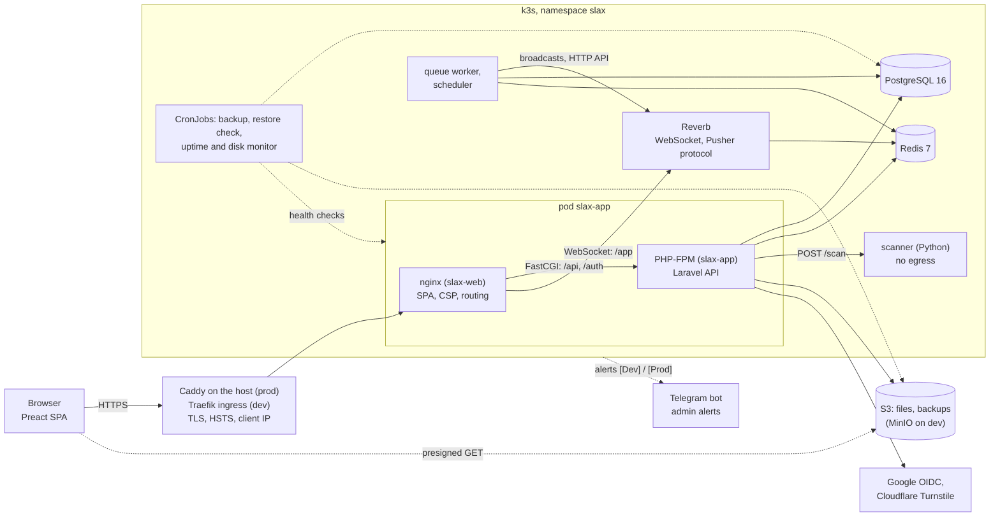
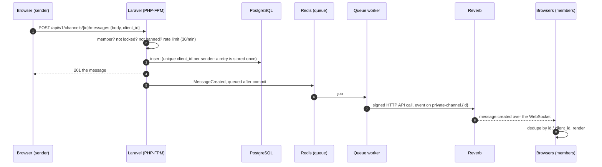
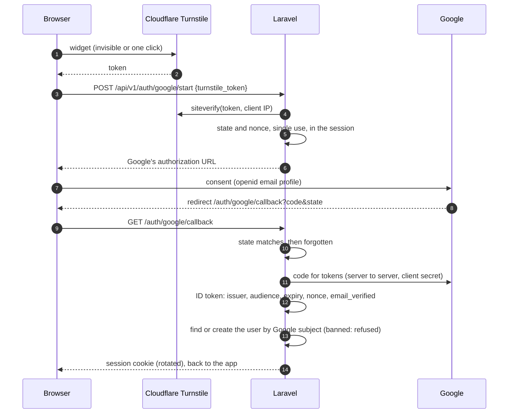
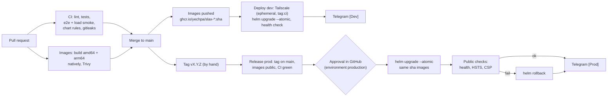

# Slax architecture

Slax is a Slack-like chat built to show one application designed, deployed and operated end
to end on a small budget. This page explains how it is put together and why. Operations are
in [runbook.md](runbook.md), the acceptance steps in [recette.md](recette.md), the known
gaps in [known-limitations.md](known-limitations.md), the visual identity in
[design-system.md](design-system.md), and the original brief in
[the design spec](superpowers/specs/2026-10-30-slax-design.md).

Contents: [1. Services](#1-services) · [2. Data flows](#2-data-flows) ·
[3. Sign-in](#3-sign-in) · [4. Environments and delivery](#4-environments-and-delivery) ·
[5. Security model](#5-security-model) · [6. Decisions](#6-decisions) ·
[7. Cost](#7-cost) · [8. Next (v2)](#8-next-v2)

## 1. Services

| Component | What it does | Image |
|---|---|---|
| SPA | Preact + TypeScript, plain modern CSS (logical properties, `@layer`, container queries), two themes, three languages | built into `slax-web` |
| nginx | Serves the SPA, sets the CSP and the other headers, routes `/api`, `/auth`, `/sanctum`, `/broadcasting` to PHP-FPM on the pod's loopback and `/app` to Reverb; `/apps` (Reverb's HTTP API) is never public | `ghcr.io/yechpa/slax-web` |
| Laravel API | Accounts, channels, messages, threads, reactions, files, presence, moderation, audit log, channel authorization | `ghcr.io/yechpa/slax-app` |
| Reverb | Laravel's WebSocket server (Pusher protocol); presence channel for the workspace, private channel per conversation | `slax-app` |
| Queue worker | Broadcasts (after the transaction commits), channel revocations, one worker so their order holds | `slax-app` |
| Scheduler | Demo reset (prod), audit pruning, orphan files, backup freshness check | `slax-app` |
| Scanner | Upload validation: type by signature (allowlist), size, hash, zip bombs and unsafe paths; reads nothing and calls nothing | `ghcr.io/yechpa/slax-scanner` |
| PostgreSQL, Redis | Data; sessions, cache, queue, presence | upstream, pinned by digest |
| Backup, restore check | Daily `pg_dump` to S3, weekly restore into a throwaway server | `ghcr.io/yechpa/slax-backup` |
| Uptime monitor | Every minute, outside Laravel: health, Reverb, PostgreSQL, Redis, the public URL, disks | `slax-backup` |

Every image is built for amd64 and arm64 by `.github/workflows/images.yml` from a commit,
tagged with its SHA, scanned by Trivy, and deployed by that tag only.

## 2. Data flows

### Sending a message

The sender shows its message at once (pending), then replaces it with the server's copy.
Nothing is lost across a reconnection: clients refetch what they missed (events are not
replayed). The load test measured this path at p50 59 ms, p99 89 ms from POST to arrival
on 50 sockets, with nothing lost or doubled ([load-test-results.md](load-test-results.md)).

### Realtime subscription and revocation

1. The SPA opens `wss://<host>/app/<key>` (nginx → Reverb) and gets a socket id.
2. For each channel it calls `POST /broadcasting/auth` with the session cookie and the
   XSRF token; Laravel checks membership **at that moment** and signs the subscription
   (with the user id inside, for presence and whispers).
3. When someone is removed from a private channel or banned, the server asks Reverb to
   close that user's connections (a custom broadcaster method); their client cannot
   subscribe again because the authorization is refused. Limits:
   [known-limitations.md](known-limitations.md#realtime-a-dishonest-client-can-keep-receiving-a-channel-after-removal).

### Files

1. Drag and drop → `POST /api/v1/files` (multipart, 10 MB, 20 uploads a minute, 100 MB per
   account).
2. Laravel streams it to the scanner (`POST /scan`): the real type from its bytes
   (PNG, JPEG, GIF, WebP, PDF, UTF-8 text, zip), the extension must agree, zips are checked
   for bombs and unsafe paths without being extracted. Refused: nothing is stored.
3. Accepted: stored privately in S3 under a random key, then the row; the file is attached
   to the message that is sent with it.
4. Download: `GET /api/v1/files/{id}/download` checks that the user may read the channel,
   then redirects to a short-lived presigned URL **on the bucket's own host** with the
   stored type and the disposition forced (`attachment` except images and PDFs). The bytes
   never go through PHP, and a file never runs on the application's origin.

### Presence and typing

- Every open tab sends `POST /api/v1/presence/heartbeat {active}` every 25 s. Redis keeps
  `presence:{user}` for 60 s and `presence:active:{user}` for 5 minutes: online, away or
  offline fall out of the keys' expiry, with no cleanup job and no state to repair after
  a crash.
- The workspace presence channel (`presence-workspace.{id}`) tells clients who joined or
  left at once; the heartbeat state is the truth for everyone else.
- "X is typing…" is a client event (whisper) on the conversation's private channel, sent at
  most every few seconds by the client; the server never stores it.

## 3. Sign-in

- No password exists anywhere in Slax; Google vouches for the address
  (`email_verified`), so there is no confirmation e-mail and no outgoing mail at all.
- Administrators are the addresses in `ADMIN_EMAILS` (a Kubernetes Secret), applied at
  each sign-in.
- The SPA uses Laravel Sanctum's cookie session (`SameSite`, `Secure`, `HttpOnly`) with the
  `XSRF-TOKEN` double-submit cookie.
- Rate limits per IP on the start and the callback; Turnstile in front of the start.
- In the end-to-end stack only (`APP_ENV=e2e`), Google is replaced by a local account
  chooser; the binding is by environment, tested, and the cluster chart refuses any
  `APP_ENV` but `production`.

## 4. Environments and delivery

| | Workstation | End-to-end | Dev | Prod |
|---|---|---|---|---|
| Where | Docker Compose, `make up` | Compose project `slax-e2e`, `make e2e` | `slax-dev`, a home server (amd64), k3s | AWS EC2 t4g.small (arm64), eu-central-1, k3s |
| Reached at | `http://localhost:8080` | inside Docker only | `https://dev.slax.yechpa.com`, tailnet only | `https://slax.yechpa.com` |
| Front | nginx + Vite dev server | nginx + built SPA | Traefik, cert-manager (DNS-01) | Caddy on the host (Let's Encrypt), no ingress controller |
| Images | development PHP image, sources mounted | same | the release images (`<sha>`) | the same `<sha>` images dev ran |
| Files | MinIO | MinIO | MinIO | S3, through the instance role |
| Google | real (your client) | stand-in account chooser | real | real |
| Deployed by | you | `make e2e` (and CI) | GitHub Actions on every merge | GitHub Actions on a `v*` tag, after approval |

One Helm chart (`deploy/helm/slax`) with `values-dev.yaml` and `values-prod.yaml`;
`make chart-lint` renders both, validates them against the Kubernetes schemas and checks
about 90 rules (security contexts, network policies, which pod gets which secret, the
monitor's settings...). Migrations follow *expand then contract*, so a rollback is a
redeploy of the previous image without undoing the schema.

## 5. Security model

| Threat | What stops it | What remains |
|---|---|---|
| A hostile upload (an executable renamed `.txt`, a polyglot, a zip bomb) | Type from the bytes against an allowlist, the extension must agree, zip checks without extraction, 10 MB / 100 MB quota; the scanner has no network egress and a read-only filesystem; files are served from the bucket's own origin with the type and `attachment` forced; the CSP allows images from that exact host only | No antivirus (ClamAV costs about 1 GB of memory: the spec let it go first); a PDF opens inline, on the isolated origin |
| Cross-site scripting | Messages are plain text rendered by Preact (escaped), never HTML; a strict CSP (`default-src 'self'`, scripts from the app and Turnstile only, `frame-ancestors 'none'`); `nosniff`; every message isolated for bidi (`dir="auto"`), bidi overrides stripped from file names | Turnstile is allowed on every page (one document) |
| Cross-site request forgery | Sanctum's stateful cookie session limited to the app's host, `X-XSRF-TOKEN` on every write, `SameSite` cookies | – |
| Account takeover, bots | Google only (no password to steal or reset), `state` and `nonce`, verified e-mail only, Turnstile before the flow, rate limits on sign-in | A Google account is as strong as its owner keeps it |
| Reading what one should not | Every channel, message, file and subscription checked on the server (membership, live at subscription); private channels; files by channel membership | A removed member's own client may keep a socket briefly (known limitations) |
| Abuse of the public demo | Rate limits (messages 30/min, uploads 20/min, DMs, searches), quotas, administrators can ban, delete, lock; the nightly reset; banned accounts kept so they cannot sign up again | – |
| Admin actions without trace | Audit log of sensitive actions with the visitor's real IP (Caddy replaces any client `X-Forwarded-For`; nginx believes the pod network only), kept 180 days | – |
| A compromised pod | Pod Security *restricted* (non-root, read-only root, no capability, seccomp), default-deny network policies (the scanner reaches nothing; PostgreSQL and Redis admit named pods only), no Kubernetes API token in any pod, the instance metadata service denied to pods without AWS needs | App, queue and scheduler can use the instance role (the two buckets only; it cannot delete backups) |
| Infrastructure exposure | Only TCP 80/443 public (security group and a host firewall); SSH and the Kubernetes API over Tailscale only; dev not reachable outside the tailnet; no SSH daemon in prod | – |
| Secrets in a public repository | Secrets only in Kubernetes Secrets and GitHub environments; gitleaks in CI and pre-commit; GitHub secret scanning and push protection; alerts never carry a secret or a user's message | – |
| Supply chain | Base images and third-party actions pinned by digest or commit; Trivy fails a build on a fixable critical vulnerability; locked dependencies | Alpine packages are upgraded at build time (two builds of one commit may differ) |

## 6. Decisions

Short records: the choice, why, and what it costs.

1. **Laravel with Reverb.** PHP is the language to show; Laravel gives authentication,
   queues, broadcasting authorization and a first-party WebSocket server speaking the
   Pusher protocol, so the browser uses the mature `pusher-js` client. No realtime SaaS.
   Cost: one Reverb process, not horizontally scalable without Redis scaling (not needed
   on one node).
2. **PostgreSQL.** Relational data with real constraints (memberships, foreign keys that
   refuse to orphan a stored file, unique `client_id` per sender for idempotent sends),
   transactions around every write, and room for full-text search later.
3. **Redis for presence, with TTLs.** A heartbeat refreshes a key that expires on its own:
   presence is right after a crash or a deploy without any cleanup. Redis also carries
   sessions, cache and the queue (`noeviction`: a full Redis refuses rather than dropping
   jobs).
4. **The scanner as a separate Python service.** Parsing hostile files is the riskiest
   code; it runs alone, read-only, with no network egress, behind one small API. It also
   shows the multi-service shape the spec asked for.
5. **S3 with presigned downloads.** The bytes never pass through PHP, and every file lives
   on an origin that is not the app's. MinIO stands in on the workstation and dev.
6. **Helm over raw manifests.** One chart, two values files, revision history and
   `helm rollback`, `--atomic` upgrades; the rendered output is checked by schema and by
   project rules in CI. No GitOps controller (Argo CD) for one cluster each: push-based
   deploys over Tailscale are enough.
7. **Caddy on the host in production.** Automatic certificates and HSTS in a few lines, the
   visitor's real address preserved, and k3s without Traefik and ServiceLB: nothing in the
   cluster listens on a public port, and less memory on a 2 GiB node.
8. **The EC2 instance role.** No AWS key anywhere: the SDKs take short-lived credentials
   from the metadata service; pods that need none are denied it.
9. **Google-only sign-in.** No passwords to store, reset or leak, verified addresses for
   free; other providers are out of the v1 scope by decision.
10. **No outgoing mail.** Google already verifies addresses, so there is no SES, SPF or
    DKIM to run; alerts go to Telegram.
11. **Telegram for administrators' alerts, and a monitor outside the app.** One bot, one
    private chat, `[Dev]` or `[Prod]` on every message. The app reports its own errors;
    a CronJob that needs no Laravel reports when the app itself is down, and the disks.
    No metrics stack: Prometheus and Grafana would not fit in 2 GiB beside everything else.
12. **Single-node k3s on t4g.small.** Kubernetes as the brief asked, at the smallest cost:
    the load test and an idle k3s measurement put the instance at about 63 % of its memory
    at the target load ([runbook.md §2](runbook.md#2-sizing-and-cost)).

## 7. Cost

Production: about **$20.9 a month** (t4g.small on demand $14.02, 30 GB gp3 $2.86, the
public IPv4 address $3.65, S3 about $0.40), slightly above the $15-20 target; a one-year
savings plan would bring it under. t4g.medium, if needed, would be about $34.9. Dev runs on
the owner's hardware; GitHub Actions (public repository), GHCR, Tailscale (personal), Let's
Encrypt, Turnstile and Telegram cost nothing. Details: [runbook.md §2](runbook.md#2-sizing-and-cost).

## 8. Next (v2)

- **Calls** (audio, video, screen sharing): a media server (an SFU such as LiveKit or
  mediasoup) and a TURN server (coturn) beside the cluster, "in a call" as a presence
  state, signalling over the existing private channels. The spec reserved the room; it
  needs a bigger instance or a second one.
- **Search**: PostgreSQL full-text search (`tsvector` per language, Hebrew included,
  indexed per channel and respecting membership), before considering a search engine.
- **Push notifications**: Web Push (VAPID, a service worker) for mentions and direct
  messages; still no e-mail.
- **More than one workspace**: the data model already carries `workspace_id`.
- **Bots and integrations**: a Python service on the same pattern as the scanner.
- **Operations**: an external uptime pinger (to see a dead node), metrics with a light
  agent if the instance grows, Reverb's Redis scaling and a second node for upgrades
  without the few seconds of WebSocket reconnection.
